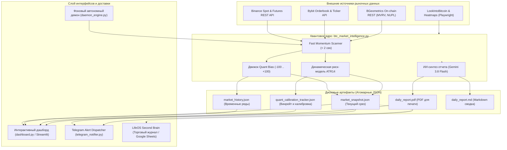

# Архитектура системы BTC Market Intelligence Terminal

---

## 1. Концепция и назначение системы

**BTC Market Intelligence Terminal** — это институциональный квантово-аналитический терминал для мониторинга рынка Bitcoin (BTC), оценки рыночного позиционирования (Quant Bias), расчета динамических уровней риска (ATR Dynamic Risk Model) и автоматизированной генерации аналитических отчетов.

Система решает ключевые задачи профессионального криптотрейдинга:
1. **Объективная квантовая оценка рынка (Quant Bias):** Устранение эмоций трейдера путем сведения десятков параметров (книга ордеров, дельта спот/фьючерсов CVD, Z-score открытого интереса и ставки финансирования, дивергенции) в единую шкалу от -100 (Extreme Bearish) до +100 (Extreme Bullish).
2. **Математическая модель риска (Dynamic ATR Risk):** Расчет обоснованных уровней входа, динамического Stop-Loss (буфер 1.5x ATR14) и целевых Take-Profit с соотношением Risk/Reward 1:2 и 1:3 для Long и Short сценариев.
3. **Ончейн-контекст макроцикла:** Экспресс-мониторинг фазы рынка через метрики MVRV Z-Score и NUPL (Net Unrealized Profit/Loss).
4. **Многоканальный вывод:** Интерактивный веб-дашборд (Streamlit/Plotly), автономный фоновый демон (`daemon_engine.py`), мгновенный консольный сканер (`--fast` < 2 сек), Telegram-оповещения и компиляция отчетов в PDF.

---

## 2. Общая схема потоков данных (Data Flow)

---

## 3. Архитектурные слои системы

### 3.1. Слой сбора данных (Data Ingestion Layer)
- **Параллельный опрос REST API:** Вызовы эндпоинтов Binance (`fapi/v1/depth`, `api/v3/depth`, `fapi/v1/openInterest`, `fapi/v1/fundingRate`, `fapi/v1/klines`) и Bybit выполняются параллельно с оптимизацией тайм-аутов (до 6 секунд).
- **Сверхбыстрый режим (Fast Mode):** Вызов `python btc_market_intelligence.py --fast` полностью отключает тяжелые браузерные скраперы Playwright, запрашивает только легковесные REST-ручки и генерирует готовый результат за 1.0–1.5 секунды.
- **Ончейн-метрики без блокировок:** Интеграция с BGeometrics REST API обеспечивает получение актуальных значений MVRV Z-Score и NUPL с автоматической классификацией фазы цикла (`Fair Value / Early Bull`, `Optimism / Anxiety`).

### 3.2. Слой квантового анализа и риск-моделирования (Core Quant & Risk)
- **Quant Bias Composite Score:** Взвешенная сумма факторов:
  - 1D VWAP Trend (-15 .. +15)
  - 24H Spot CVD (-20 .. +20)
  - Spot Orderbook Imbalance (-10 .. +10)
  - Futures Orderbook Imbalance (-15 .. +15)
  - 24H Divergence Engine (-15 .. +15)
  - Итоговый диапазон: от -100 до +100 с семантическими метками: `EXTREME_BULLISH` (> +60), `BULLISH` (+20 .. +60), `NEUTRAL` (-20 .. +20), `BEARISH` (-60 .. -20), `EXTREME_BEARISH` (< -60).
- **Динамическая модель риска ATR (Average True Range):**
  - Расчет ATR за 14 периодов.
  - Буфер защитного стоп-лосса: `1.5 * ATR14`.
  - Целевые уровни прибыли с жестким матожиданием: `TP1 = 2 * Risk` (R:R 1:2), `TP2 = 3 * Risk` (R:R 1:3).
  - Формирование полной спецификации сделки для обоих направлений и автоматическая рекомендация на основе доминирующего Quant Bias.
- **Движок калибровки винрейта (Calibration Engine):**
  - Сохранение истории сигналов в `quant_calibration_tracker.json`.
  - Автоматическая валидация исхода сделок (достижение TP1/TP2 раньше SL) с расчетом исторического винрейта.

### 3.3. Слой представления и визуализации (Streamlit Dashboard)
- **Фреймворк:** `streamlit 1.35+` и `plotly 5.20+`.
- **Компоненты:**
  - Полукруглый спидометр (Gauge) Quant Bias с цветовыми зонами.
  - Горизонтальный график декомпозиции весов факторов.
  - Интерактивный ценовой график со скользящими уровнями Stop-Loss и Take-Profit.
  - Многопериодный график дельты CVD и Z-score открытого интереса.
  - Встроенный просмотрщик сформированного PDF-отчета (`daily_report.pdf`) через Base64-фрейм.
  - Панель управления ручным запуском сканирования в 1 клик.

### 3.4. Слой фоновой автоматизации (Daemon Engine)
- **Файл:** `daemon_engine.py`.
- **Механизм:** Неблокирующий фоновый процесс с записью PID-файла и обработкой системных сигналов `SIGINT` / `SIGTERM`.
- **Атомарность персистентности:** Запись `market_snapshot.json` производится через временный файл `.tmp` с атомарным замещением (`replace`), что исключает повреждение данных или чтение неполного JSON другими процессами и дашбордом.
- **Статус-пульс:** Запись `daemon_status.json` с фиксацией времени последней итерации, статуса здоровья и ошибок.

### 3.5. Слой уведомлений (Telegram Alert Dispatcher)
- **Файл:** `telegram_notifier.py`.
- **Функции:**
  - Мгновенная отправка экстренных алертов при выходе Quant Bias в экстремальные зоны.
  - Отправка ежедневного сводного PDF-отчета руководителю.
  - Поддержка форматирования HTML и отправки вложений через официальный Telegram Bot API.

---

## 4. Контроль отказоустойчивости и офлайн-тестирование

1. **Встроенный автономный тестовый комплекс (`--self-test`):**
   - 13 тестовых наборов покрывают: математику расчета Z-score (включая нулевую дисперсию), логику расчета ATR-уровней, парсинг ETF, скоринг Quant Bias и симуляцию быстрого сканирования.
   - Тесты выполняются полностью офлайн без обращения к сети и завершаются с кодом возврата `0`.
2. **Деградация функционала (Graceful Degradation):**
   - При отказе одного из внешних API (например, недоступность BGeometrics) система помечает статус ончейн-блока как `UNAVAILABLE`, но продолжает рассчитывать биржевые индикаторы и деривативы без падения всего скрипта.
3. **Безопасность параллельного чтения:**
   - Гарантируется методом `atomic_write_json`.

---

## 5. Интеграция в цифровую экосистему Second Brain

Терминал `btc-market-intelligence` напрямую связывается с персональной системой `LifeOS`:
* **Журнал сделок LifeOS (`Trading Journal`):** Уровни Stop-Loss, TP1 (1:2) и TP2 (1:3), рассчитанные терминалом, служат эталоном для ведения сделок в таблице `Trading Journal` в Google Sheets.
* **Утренний брифинг LifeOS (09:00):** Значение Quant Bias и рекомендации терминала могут автоматически транслироваться в ежедневный брифинг руководителя в Telegram.
* **Единый технологический стек:** Проекты разделяют единый системный часовой пояс (`Europe/Riga`), общие стандарты оформления (Zero Emojis), типизацию Python 3.14 и управление зависимостями через `uv`.
